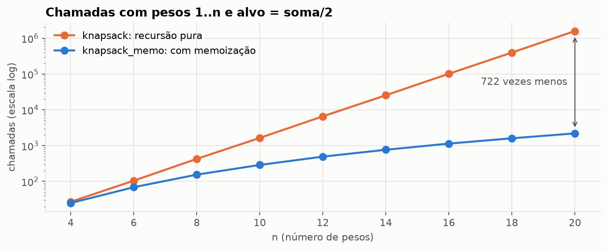
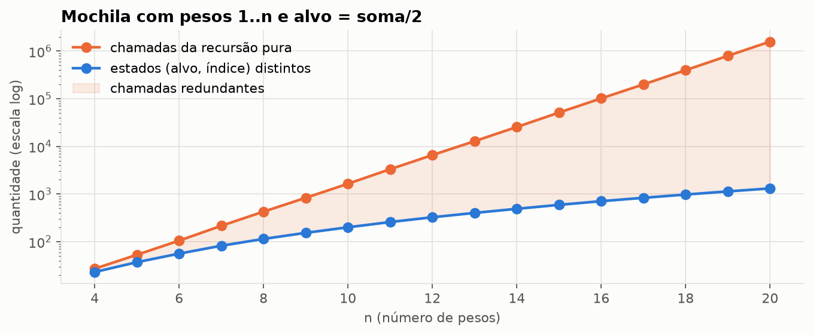
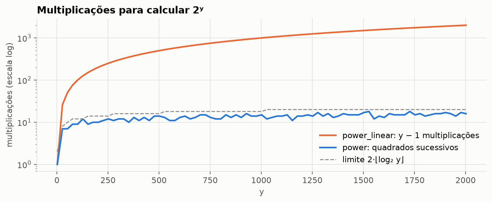
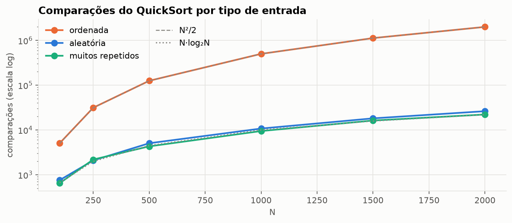
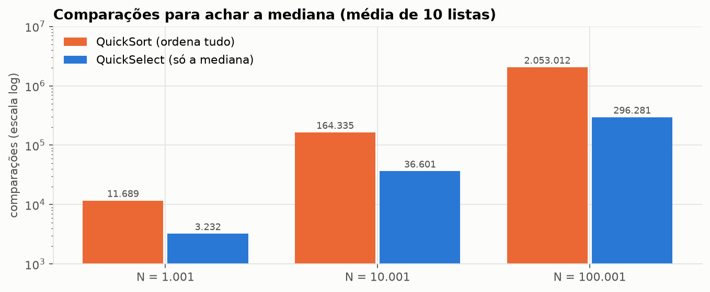
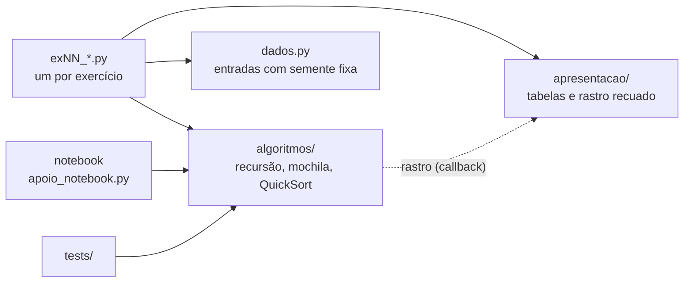

<div align="center">


# 🔁 Recursão, Programação Dinâmica e QuickSort

**Casos base explícitos, chamadas contadas e rastreadas, a explosão combinatória da mochila resolvida com memoização, e QuickSort e QuickSelect instrumentados sobre os mesmos dados**

<sub>DR1-TP3 · Bloco Ciência da Computação · Trabalho individual</sub>

<br/>

[](andre_becker_DR1_TP3.ipynb)
[](https://nbviewer.org/github/andrebecker84/dr1-tp3-recursao-quicksort/blob/main/andre_becker_DR1_TP3.ipynb)
[](docs/RELATORIO_TP3.md)

<br/>

[](#stack)
[-E95420?style=flat-square&logo=ubuntu&logoColor=white)](#stack)
[](#stack)
[](#testes)
[%20%C2%B7%20O(N%20log%20N)%20%C2%B7%20O(2%E2%81%BF)-6250D6?style=flat-square)](#exercicios)
[](LICENSE)
[](#estado)

<br/>



<sub>Mochila com 20 pesos: 1.587.347 chamadas na recursão pura contra 2.199 com memoização, com as mesmas soluções (Exercício 8).</sub>

</div>

---

<a id="indice"></a>

## 📚 Índice

| | O trabalho | | Qualidade e entrega |
|:---:|---|:---:|---|
| 01 | [Visão geral](#visao-geral) | 07 | [Testes automatizados](#testes) |
| 02 | [Os 12 exercícios](#exercicios) | 08 | [Atendimento à rubrica](#atendimento) |
| 03 | [Gráficos](#graficos) | 09 | [Estrutura do projeto](#estrutura) |
| 04 | [Arquitetura](#arquitetura) | 10 | [Estado do projeto](#estado) |
| 05 | [Stack](#stack) | 11 | [Referências](#referencias) |
| 06 | [Como executar](#como-executar) | 12 | [Licença](#licenca) |

---

<a id="visao-geral"></a>

## 💡 Visão geral

Teste de Performance com 12 exercícios sobre recursão, programação dinâmica, ordenação e seleção.
Como nos TPs anteriores, meço o custo **contando passos** (chamadas, profundidade da pilha, somas,
multiplicações, tentativas de divisão, comparações e cópias), não tempo, e uso a notação Big O para
explicar como ele cresce.

| Tema | Ex. | O que o trabalho mostra |
|:---:|:---:|---|
|  | 1 a 4 | casos base explícitos, o rastro de chamadas e retornos e a recursão sobre números e sobre uma árvore de diretórios |
|  | 5 e 6 | inclusão e exclusão em times e na mochila, e a explosão de 2ⁿ⁺¹ − 1 chamadas |
|  | 7 e 8 | 99,9% de chamadas redundantes medidas e eliminadas com memoização |
|  | 9 a 12 | QuickSort e QuickSelect com pivô no último elemento, comparações e cópias em cinco tipos de entrada |

As telas são da execução real no meu terminal, o **WezTerm** com o Ubuntu do WSL2 e o shell fish,
capturadas direto da janela. Cada script confere o próprio resultado com `[OK]` ou `[FALHA]`.

> **Bloco:** Ciência da Computação  
> **Disciplina:** Velocidade e Qualidade com Estruturas de Dados e Algoritmos  
> **Trimestre:** 26E4  
> **Professor:** Ian Monteiro Nunes  
> **Aluno:** André Luis Becker  
> **Sala:** GRLENGR2C2-N2-L1  
> **Modalidade:** Individual

> [!IMPORTANT]
> **Decisões declaradas**
> - Os nomes e parâmetros pedidos no enunciado foram mantidos (`mult(x, y)`, `factor(x, lowest=2)`,
>   `power(x, y)`, `teams(candidates, k)`, `knapsack(target, weights, index)`); os contadores e o
>   rastro entram como parâmetros opcionais.
> - `factor(0)` é `[0]`, `factor(1)` é `[]` e um negativo ganha o fator −1: o produto da lista é
>   sempre x.
> - `power` usa quadrados sucessivos (O(log y)); a versão linear existe só para comparar.
> - A travessia de diretórios usa `os.scandir`, que lê um nível; `os.walk` aparece só na verificação.
> - Na partição do QuickSort, os ponteiros param em valores iguais ao pivô, e a troca de uma posição
>   com ela mesma não é feita nem contada.
> - Os slides disponíveis vão até a Aula 5, que não trata destes temas. A teoria cita a bibliografia
>   do enunciado (Wengrow, caps. 10 a 13) e os clássicos (Canning, Broder e Lafore; Cormen; Hoare).

<p align="right"><a href="#indice">⬆ voltar ao índice</a></p>

---

<a id="exercicios"></a>

## 🧭 Os 12 exercícios

#### 🔁 Recursão · Ex. 1 a 4

| Ex. | Problema | Técnica | Resultado principal | Big O | Notebook |
|:---:|---|---|---|---|:---:|
| 1 | Multiplicação por soma | recursão linear | y + 1 chamadas; a soma acontece no retorno | O(y) | [ver](https://nbviewer.org/github/andrebecker84/dr1-tp3-recursao-quicksort/blob/main/andre_becker_DR1_TP3.ipynb#ex01) |
| 2 | Fatoração de inteiros | recursão com `lowest` | 999 tentativas para o primo 1.000.003, contra 1.000.002 | O(√x) | [ver](https://nbviewer.org/github/andrebecker84/dr1-tp3-recursao-quicksort/blob/main/andre_becker_DR1_TP3.ipynb#ex02) |
| 3 | Potenciação com expoente negativo | quadrados sucessivos | 25 multiplicações para y = 1.000.000 | O(log y) | [ver](https://nbviewer.org/github/andrebecker84/dr1-tp3-recursao-quicksort/blob/main/andre_becker_DR1_TP3.ipynb#ex03) |
| 4 | Navegação em diretórios | recursão em árvore | 1 chamada por diretório, sem `os.walk` | O(D + A) | [ver](https://nbviewer.org/github/andrebecker84/dr1-tp3-recursao-quicksort/blob/main/andre_becker_DR1_TP3.ipynb#ex04) |

#### 🧮 Combinatória · Ex. 5 e 6

| Ex. | Problema | Técnica | Resultado principal | Big O | Notebook |
|:---:|---|---|---|---|:---:|
| 5 | Times de k candidatos | inclusão e exclusão | 12.870 times de 8 entre 16, nenhum repetido | O(2ⁿ) | [ver](https://nbviewer.org/github/andrebecker84/dr1-tp3-recursao-quicksort/blob/main/andre_becker_DR1_TP3.ipynb#ex05) |
| 6 | Mochila | inclusão e exclusão | 2.097.151 chamadas com 20 pesos e alvo inatingível | O(2ⁿ) | [ver](https://nbviewer.org/github/andrebecker84/dr1-tp3-recursao-quicksort/blob/main/andre_becker_DR1_TP3.ipynb#ex06) |

#### 🧠 Programação dinâmica · Ex. 7 e 8

| Ex. | Problema | Técnica | Resultado principal | Big O | Notebook |
|:---:|---|---|---|---|:---:|
| 7 | Chamadas redundantes | estados (alvo, índice) | 1.587.347 chamadas para 1.310 estados distintos | O(2ⁿ) | [ver](https://nbviewer.org/github/andrebecker84/dr1-tp3-recursao-quicksort/blob/main/andre_becker_DR1_TP3.ipynb#ex07) |
| 8 | Memoização | dicionário de estados | 1.587.347 → 2.199 chamadas; 100 pesos viáveis | O(2ⁿ) → O(n · alvo) | [ver](https://nbviewer.org/github/andrebecker84/dr1-tp3-recursao-quicksort/blob/main/andre_becker_DR1_TP3.ipynb#ex08) |

#### 🔃 Ordenação e seleção · Ex. 9 a 12

| Ex. | Problema | Técnica | Resultado principal | Big O | Notebook |
|:---:|---|---|---|---|:---:|
| 9 | QuickSort | pivô no último elemento | profundidade 24 (aleatória) x 2.000 (ordenada) | O(N log N) a O(N²) | [ver](https://nbviewer.org/github/andrebecker84/dr1-tp3-recursao-quicksort/blob/main/andre_becker_DR1_TP3.ipynb#ex09) |
| 10 | Instrumentação | comparações e cópias (troca = 3) | ordenada: N(N+1)/2 − 2 comparações e 0 cópias | O(N log N) a O(N²) | [ver](https://nbviewer.org/github/andrebecker84/dr1-tp3-recursao-quicksort/blob/main/andre_becker_DR1_TP3.ipynb#ex10) |
| 11 | QuickSelect | partição e um lado só | mediana de 100.001 com 2,7 comparações por elemento | O(N) médio | [ver](https://nbviewer.org/github/andrebecker84/dr1-tp3-recursao-quicksort/blob/main/andre_becker_DR1_TP3.ipynb#ex11) |
| 12 | QuickSort x QuickSelect | mesmos dados | seleção de 3,6 a 6,9 vezes mais barata, crescendo com N | O(N log N) x O(N) | [ver](https://nbviewer.org/github/andrebecker84/dr1-tp3-recursao-quicksort/blob/main/andre_becker_DR1_TP3.ipynb#ex12) |

O [notebook](andre_becker_DR1_TP3.ipynb) segue o mesmo roteiro em todos os exercícios: selos e
indicadores, 📐 fundamentação, 🧩 implementação, 🖥️ execução no terminal e 📊 análise. O
[relatório](docs/RELATORIO_TP3.md) reúne as telas com o trecho de código e o resultado, e é a base do
PDF de entrega. O texto completo do [enunciado](docs/context/enunciado-DR1-TP3.md) e da
[rubrica](docs/context/rubrica-DR1-TP3.md) está em `docs/context/`.

<p align="right"><a href="#indice">⬆ voltar ao índice</a></p>

---

<a id="graficos"></a>

## 📈 Gráficos

<table>
<tr>
<td width="50%"><br/><sub><b>Ex. 7</b> · chamadas exponenciais para estados polinomiais: a diferença é redundância</sub></td>
<td width="50%"><br/><sub><b>Ex. 3</b> · y − 1 multiplicações contra no máximo 2·⌊log₂ y⌋</sub></td>
</tr>
<tr>
<td width="50%"><br/><sub><b>Ex. 10</b> · a lista ordenada segue N²/2; aleatória e repetidos, N·log₂N</sub></td>
<td width="50%"><br/><sub><b>Ex. 12</b> · a distância entre ordenar e selecionar cresce com N</sub></td>
</tr>
</table>

<p align="right"><a href="#indice">⬆ voltar ao índice</a></p>

---

<a id="arquitetura"></a>

## 🏗️ Arquitetura



| Camada | Pasta | Papel |
|---|---|---|
| Modelo | `src/algoritmos/` | Algoritmos puros: recebem dados, devolvem o resultado e somam os passos num objeto `Metricas`, sem `print` |
| Visão | `src/apresentacao/`, `src/apoio_notebook.py` | Tabelas, `[OK]`/`[FALHA]` e o rastro recuado por nível no terminal; cartões, figuras e gráficos no notebook |
| Controle | `src/exNN_*.py` | Monta os dados do exercício, chama o núcleo e manda para a visão |
| Testes | `src/tests/` | 36 testes do núcleo |

### 🧩 Princípios aplicados

- **Responsabilidade única:** algoritmo, contagem (`Metricas`), dados, verificação e saída ficam em
  módulos separados.
- **Observer:** os callbacks `rastro`, `ao_visitar` e `ao_particionar` mostram chamadas, retornos,
  estados e partições sem `print` dentro do algoritmo.
- **DRY:** a mesma `particionar` serve ao QuickSort e ao QuickSelect, e o `knapsack` do Exercício 6 é
  o mesmo analisado no 7 e otimizado no 8.
- **Verificação independente:** `verificacao.py` usa `os.walk`, `itertools` e força bruta por máscaras
  de bits só para conferir os resultados, nunca dentro dos algoritmos.
- **YAGNI:** sem interfaces formais nem dependências externas; o notebook é a única parte que usa
  `matplotlib`.

<p align="right"><a href="#indice">⬆ voltar ao índice</a></p>

---

<a id="stack"></a>

## 🛠️ Stack

| Item | Uso |
|---|---|
| **Python 3.15.2** | Versão do projeto, fixada no `.python-version` com o `uv`. Usada no Windows 11 e no Ubuntu 24.04 (WSL2), onde rodaram os prints. O código funciona a partir do Python 3.11 (`enum.StrEnum`). |
| **Biblioteca padrão** | `os`, `sys`, `math`, `random`, `tempfile`, `itertools`, `collections`, `dataclasses`, `enum`, `time`, `unittest`. Os exercícios não têm dependência externa. |
| **WezTerm + fish** | Terminal das evidências, com o Ubuntu do WSL2; as telas são capturadas direto da janela, sem recorte nem edição. |
| **Jupyter + matplotlib** | Só no notebook. Ele é executado no Python 3.12, porque o `matplotlib` ainda não tem pacote para o 3.15. |

<p align="right"><a href="#indice">⬆ voltar ao índice</a></p>

---

<a id="como-executar"></a>

## ▶️ Como executar

### Pré-requisitos

- Python 3.11 ou superior. Nada para instalar além dele.
- O projeto fixa o **3.15.2** no `.python-version`. Com o [uv](https://docs.astral.sh/uv/), ele é
  instalado com `uv python install 3.15.2`.

### Exercícios

Cada exercício é um script independente, executado de dentro de `src/`:

```bash
cd src
python ex01_mult.py
python ex12_quicksort_x_quickselect.py
```

### Menu de demonstração

O `demo.py` reúne tudo num menu: cada opção mostra o comando, roda o exercício com um progresso em
braile e exibe a saída uma seção por tela (Enter passa para a próxima), sem precisar rolar o terminal.

```bash
cd src
python demo.py
```

### Notebook

Abra o [`andre_becker_DR1_TP3.ipynb`](andre_becker_DR1_TP3.ipynb) aqui no GitHub ou, com o visual
completo, no [nbviewer](https://nbviewer.org/github/andrebecker84/dr1-tp3-recursao-quicksort/blob/main/andre_becker_DR1_TP3.ipynb).
Para executar de novo, os gráficos precisam do `matplotlib`.

> [!TIP]
> No Linux e no WSL, use `python3` no lugar de `python`. Os resultados são os mesmos em qualquer
> sistema, por causa da semente fixa; só os tempos do Exercício 8 mudam de uma máquina para outra.

<p align="right"><a href="#indice">⬆ voltar ao índice</a></p>

---

<a id="testes"></a>

## ✅ Testes automatizados

| Arquivo | Testes | O que confere |
|---|:---:|---|
| `src/tests/test_recursao.py` | 23 | mult igual a x * y e a ordem dos eventos (soma no retorno); fatoração de −500 a 5.000 e casos especiais; power igual a `**` e o limite de 2⌊log₂ y⌋ multiplicações; travessia igual ao `os.walk` e sem travessia pronta no código; teams igual ao `itertools`; knapsack igual à força bruta e com 2ⁿ⁺¹ − 1 chamadas; memoização com as mesmas soluções e o limite de estados |
| `src/tests/test_ordenacao.py` | 13 | partição do exemplo do livro e lados do pivô; QuickSort igual ao `sorted()` em 2.000 listas, entrada intacta, fórmulas do pior caso e cópias múltiplas de 3; QuickSelect em todos os índices, mediana e índice inválido |

```bash
cd src
python -m unittest discover -s tests -t . -v
```

<p align="right"><a href="#indice">⬆ voltar ao índice</a></p>

---

<a id="atendimento"></a>

## 🎯 Atendimento à rubrica

| Critério | Onde está |
|---|---|
| Implementa algoritmos recursivos com casos base corretos | Tabelas de casos base nos Ex. 1, 2, 3, 5 e 6; caso base implícito no Ex. 4; trecho de 0 ou 1 elemento nos Ex. 9 e 11 |
| Identifica redundâncias e problemas em algoritmos recursivos | Ex. 7: estados repetidos contados; Ex. 6: explosão 2ⁿ⁺¹ − 1; limite de recursão e entradas que impediriam o caso base (Ex. 1 e 2) |
| Aplica programação dinâmica para reduzir custo | Ex. 8: memoização, 1.587.347 → 2.199 chamadas e 100 pesos resolvidos |
| Implementa e instrumenta QuickSort e QuickSelect | Ex. 9 a 11: comparações, cópias (troca = 3), chamadas e profundidade |
| Relaciona estrutura recursiva e complexidade em Big O | Tabela de recorrências do Ex. 7, O(log y) no Ex. 3 e O(N log N) x O(N) no Ex. 12 |
| Explica decisões técnicas no vídeo | Vídeo de 4 a 6 minutos com quatro exercícios; link no fim do PDF de entrega |
| Organiza e documenta código e evidências | Notebook com sumário e o mesmo roteiro por exercício, 13 telas, saídas em texto em `evidencias/saidas/` e 36 testes |

<p align="right"><a href="#indice">⬆ voltar ao índice</a></p>

---

<a id="estrutura"></a>

## 📁 Estrutura do projeto

```
DR1_TP3/
├── andre_becker_DR1_TP3.ipynb   notebook com a análise completa
├── LICENSE                      licença de código visível, com o aviso LGPD
├── src/
│   ├── algoritmos/              recursão, mochila, partição, QuickSort, QuickSelect e métricas (sem entrada e saída)
│   ├── apresentacao/            tabelas e rastro recuado do terminal
│   ├── tests/                   36 testes
│   ├── apoio_notebook.py        cartões, tabelas, figuras e gráficos do notebook
│   ├── dados.py                 entradas dos experimentos e a árvore de diretórios de exemplo
│   ├── verificacao.py           conferências independentes (os.walk, itertools, força bruta)
│   ├── demo.py                  menu de demonstração
│   └── ex01 ... ex12            um script por exercício
├── docs/
│   ├── RELATORIO_TP3.md         telas, trechos de código e resultados (base do PDF)
│   └── context/                 enunciado e rubrica
└── evidencias/
    ├── telas/                   prints do WezTerm
    ├── graficos/                gráficos do notebook
    └── saidas/                  texto de cada tela
```

<p align="right"><a href="#indice">⬆ voltar ao índice</a></p>

---

<a id="estado"></a>

## 📌 Estado do projeto

Os 12 exercícios estão implementados, executados e documentados, e os 36 testes passam. O documento
de entrega (`andre_becker_DR1_TP3.pdf`, com as telas e o link do vídeo no fim) vai pela plataforma do
Infnet e não é versionado aqui.

<p align="right"><a href="#indice">⬆ voltar ao índice</a></p>

---

<a id="referencias"></a>

## 📖 Referências

- WENGROW, J. *A Common-Sense Guide to Data Structures and Algorithms in Python*, vol. 1. Pragmatic Bookshelf, 2023. Caps. 10 a 13.
- CANNING, J.; BRODER, A.; LAFORE, R. *Data Structures & Algorithms in Python*. Addison-Wesley, 2022. Caps. 6 e 7.
- CORMEN, T. H. et al. *Algoritmos: teoria e prática*. 3. ed. Elsevier, 2012. Caps. 7, 9 e 15.
- HOARE, C. A. R. Quicksort. *The Computer Journal*, v. 5, n. 1, 1962; e Algorithm 65: Find. *Communications of the ACM*, v. 4, n. 7, 1961.
- BELLMAN, R. *Dynamic Programming*. Princeton University Press, 1957.

<p align="right"><a href="#indice">⬆ voltar ao índice</a></p>

---

<a id="licenca"></a>

## 📜 Licença

Copyright © 2026 André Luis Becker. Todos os direitos reservados, sobre a contribuição original
deste trabalho.

Este repositório é **de código visível (source-available), não de código aberto**. É público para
ser lido, estudado e avaliado, e o corpo docente da instituição avaliadora pode executá-lo
livremente para conferir a entrega. Qualquer outro uso, incluindo clonar, executar, modificar ou
redistribuir, depende de autorização escrita.

O enunciado, a rubrica e as definições fornecidas pelo professor não são alcançados por esta
licença e seguem os termos de seus autores.

Os termos completos, com o anexo de proteção de dados (LGPD), estão na [LICENSE](LICENSE). Pedidos
de autorização são gratuitos: abra uma [issue](https://github.com/andrebecker84/dr1-tp3-recursao-quicksort/issues).

<p align="right"><a href="#indice">⬆ voltar ao índice</a></p>
