<div align="center">


# 📑 Recursão, Programação Dinâmica e QuickSort em Python

**Evidências de execução dos 12 exercícios: o trecho principal do código, a tela do terminal e o resultado**

[](https://nbviewer.org/github/andrebecker84/dr1-tp3-recursao-quicksort/blob/main/andre_becker_DR1_TP3.ipynb)
[](context/enunciado-DR1-TP3.md)
[](context/rubrica-DR1-TP3.md)
[](../README.md)

</div>

| | |
|---|---|
| **Bloco** | Ciência da Computação · DR1-TP3 |
| **Disciplina** | Velocidade e Qualidade com Estruturas de Dados e Algoritmos |
| **Trimestre** | 26E4 |
| **Professor** | Ian Monteiro Nunes |
| **Aluno** | André Luis Becker |
| **Sala** | GRLENGR2C2-N2-L1 |
| **Repositório** | [andrebecker84/dr1-tp3-recursao-quicksort](https://github.com/andrebecker84/dr1-tp3-recursao-quicksort) |

<!--
Base do documento de entrega em PDF. Os blocos "codigo" reproduzem trechos de src/; o que fica entre
"so-github" e as âncoras <a id> aparece só aqui, no GitHub.
A análise completa, com a teoria e os gráficos, está no notebook andre_becker_DR1_TP3.ipynb.
-->

<!-- so-github -->
<a id="sumario"></a>

## 📚 Sumário

| | Seção | | Seção |
|:-:|---|:-:|---|
| | [Apresentação](#apresentacao) | 7 | [Análise de complexidade](#exercicio-7) |
| 1 | [Multiplicação recursiva por soma](#exercicio-1) | 8 | [Programação dinâmica](#exercicio-8) |
| 2 | [Fatoração recursiva de inteiros](#exercicio-2) | 9 | [QuickSort](#exercicio-9) |
| 3 | [Potenciação com expoente negativo](#exercicio-3) | 10 | [Instrumentação do QuickSort](#exercicio-10) |
| 4 | [Navegação em diretórios](#exercicio-4) | 11 | [QuickSelect](#exercicio-11) |
| 5 | [Combinações (times)](#exercicio-5) | 12 | [QuickSort x QuickSelect](#exercicio-12) |
| 6 | [Problema da mochila](#exercicio-6) | | [Testes](#testes) · [Referências](#referencias) · [Vídeo](#video) |

---
<!-- /so-github -->

<a id="apresentacao"></a>

## Apresentação

Implementei os 12 exercícios em Python 3.15.2, só com a biblioteca padrão. Os prints são do meu
terminal, o WezTerm com o Ubuntu 24.04 do WSL2 e o shell fish, e foram capturados direto da janela,
sem edição. Como nos TPs anteriores, meço o custo contando passos: chamadas, profundidade da pilha,
somas, multiplicações, tentativas de divisão, comparações e cópias. Cada script confere o próprio
resultado com `[OK]` ou `[FALHA]`.

| Ex. | Problema | Técnica | Resultado | Big O |
|---|---|---|---|---|
| 1 | Multiplicação por soma | recursão linear | a soma acontece no retorno | O(y) |
| 2 | Fatoração | recursão com lowest | 999 tentativas para o primo 1.000.003 | O(√x) |
| 3 | Potenciação | quadrados sucessivos | 25 multiplicações para y = 1.000.000 | O(log y) |
| 4 | Diretórios | recursão em árvore | 1 chamada por diretório, sem os.walk | O(D + A) |
| 5 | Times | inclusão e exclusão | C(n, k) times, nenhum repetido | O(2ⁿ) |
| 6 | Mochila | inclusão e exclusão | 2ⁿ⁺¹ − 1 chamadas sem solução | O(2ⁿ) |
| 7 | Redundância | análise da mochila | 99,9% das chamadas repetidas (n = 20) | O(2ⁿ) |
| 8 | Memoização | programação dinâmica | 1.587.347 → 2.199 chamadas | O(n · alvo) |
| 9 | QuickSort | pivô no último elemento | profundidade 24 (aleatória) x 2.000 (ordenada) | O(N log N) a O(N²) |
| 10 | Instrumentação | comparações e cópias | ordenada: N(N+1)/2 − 2 comparações, 0 cópias | O(N log N) a O(N²) |
| 11 | QuickSelect | partição e um lado só | mediana de 100.001 com 2,7 comparações por elemento | O(N) |
| 12 | QuickSort x QuickSelect | mesmos dados | seleção de 3,6 a 6,9 vezes mais barata | O(N log N) x O(N) |

Os 36 testes de `src/tests/` passam (Figura 13). O notebook, com a teoria, os gráficos e as
justificativas de cada exercício, e o código estão no repositório:

[Repositório no GitHub: andrebecker84/dr1-tp3-recursao-quicksort](https://github.com/andrebecker84/dr1-tp3-recursao-quicksort)

[Notebook no nbviewer: andre_becker_DR1_TP3.ipynb](https://nbviewer.org/github/andrebecker84/dr1-tp3-recursao-quicksort/blob/main/andre_becker_DR1_TP3.ipynb)

<a id="exercicio-1"></a>

## Exercício 1: Multiplicação recursiva por soma

<!-- so-github -->
 
<!-- /so-github -->

<!-- codigo: algoritmos/aritmetica.py mult,mult_acumulando -->
```python
def mult(x, y, metricas=None, rastro=None, nivel=1):
    if nivel == 1:
        _exigir_natural(y)
    metricas = metricas or Metricas()
    metricas.entrar(nivel)
    avisar(rastro, "chamada", nivel, f"mult({x}, {y})")
    if y == 0:
        avisar(rastro, "base", nivel, "caso base y = 0: devolve 0")
        return 0
    parcial = mult(x, y - 1, metricas, rastro, nivel + 1)
    resultado = x + parcial                 # a soma só acontece aqui, quando a chamada de baixo retorna
    metricas.somas += 1
    avisar(rastro, "retorno", nivel, f"{x} + {parcial} = {resultado}")
    return resultado

def mult_acumulando(x, y, acumulado=0, metricas=None, rastro=None, nivel=1):
    if nivel == 1:
        _exigir_natural(y)
    metricas = metricas or Metricas()
    metricas.entrar(nivel)
    avisar(rastro, "chamada", nivel, f"mult_acumulando({x}, {y}, acumulado={acumulado})")
    if y == 0:
        avisar(rastro, "base", nivel, f"caso base y = 0: devolve o acumulado {acumulado}")
        return acumulado
    metricas.somas += 1                     # a soma acontece antes da chamada, no argumento
    resultado = mult_acumulando(x, y - 1, acumulado + x, metricas, rastro, nivel + 1)
    avisar(rastro, "retorno", nivel, f"repassa {resultado}, sem nenhuma conta")
    return resultado
```
<!-- /codigo -->

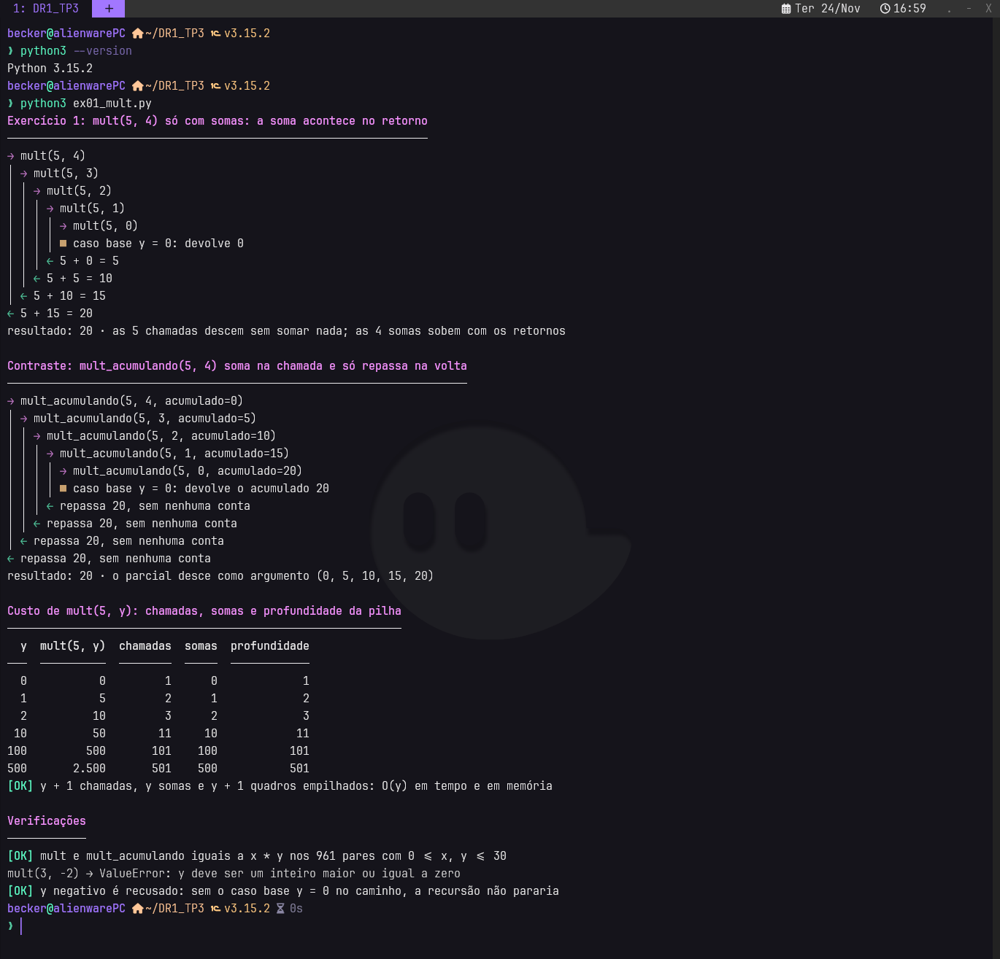

O caso base é `mult(x, 0) = 0` e o caso recursivo é `x + mult(x, y − 1)`. O rastro mostra que as 5
chamadas descem sem somar nada: como o Python precisa do resultado da chamada interna para fazer
`x + ...`, as 4 somas acontecem **no retorno** (5 + 0, 5 + 5, 5 + 10, 5 + 15). Na versão
`mult_acumulando`, a soma vai no argumento, **na chamada**, e a volta só repassa o 20. São y + 1
chamadas, y somas e y + 1 quadros na pilha: **O(y)** em tempo e memória. y negativo é recusado, porque
a recursão nunca chegaria ao caso base.

<!-- so-github -->
<p align="right"><a href="#sumario">⬆ voltar ao sumário</a></p>
<!-- /so-github -->

<a id="exercicio-2"></a>

## Exercício 2: Fatoração recursiva de inteiros

<!-- so-github -->
 
<!-- /so-github -->

<!-- codigo: algoritmos/fatoracao.py factor -->
```python
def factor(x, lowest=2, metricas=None, rastro=None, nivel=1):
    if isinstance(x, bool) or not isinstance(x, int):
        raise ValueError("x deve ser inteiro")
    if not isinstance(lowest, int) or lowest < 2:
        raise ValueError("lowest deve ser um inteiro maior ou igual a 2")
    metricas = metricas or Metricas()
    metricas.entrar(nivel)
    if x < 0:
        avisar(rastro, "base", nivel, f"factor({x}): negativo, separa o −1")
        return [-1] + factor(-x, lowest, metricas, rastro, nivel + 1)
    if x < 2:
        avisar(rastro, "base", nivel, f"factor({x}): caso especial")
        return [0] if x == 0 else []
    limite = isqrt(x)
    for divisor in range(lowest, limite + 1):
        metricas.divisoes += 1
        if x % divisor == 0:
            avisar(rastro, "chamada", nivel, f"factor({x}, {lowest}): {divisor} divide, segue com {x // divisor}")
            return [divisor] + factor(x // divisor, divisor, metricas, rastro, nivel + 1)
    avisar(rastro, "base", nivel, f"factor({x}, {lowest}): nenhum divisor até √{x} ≈ {limite}, {x} é primo")
    return [x]
```
<!-- /codigo -->

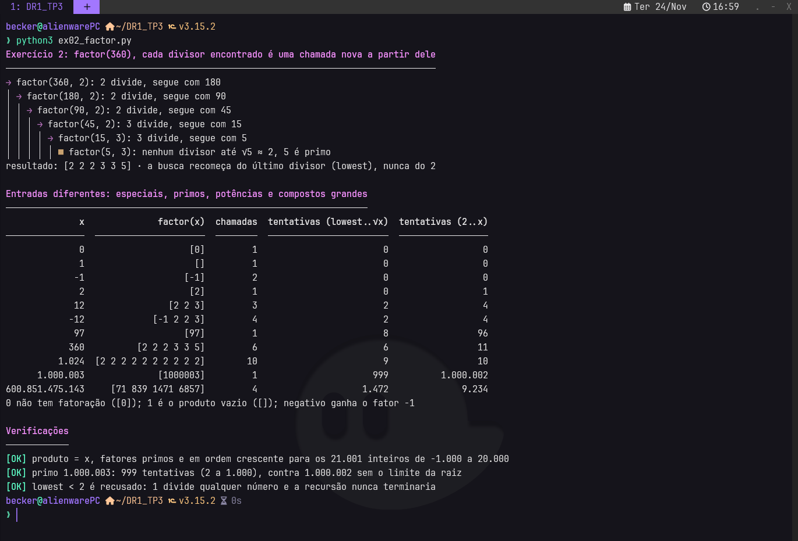

Os divisores vão de `lowest` até √x: se nenhum divide x, x é primo (caso base). Cada divisor achado
vira um fator, e a chamada seguinte começa nele mesmo, porque os menores já foram retirados. Casos
especiais: negativo ganha o fator −1, `factor(1)` é `[]` (o produto vazio vale 1) e `factor(0)` é
`[0]`, porque todo inteiro divide 0; assim o produto da lista é sempre x. Para o primo 1.000.003 foram
**999 tentativas**, contra 1.000.002 testando até x. O pior caso é **O(√x)**.

<!-- so-github -->
<p align="right"><a href="#sumario">⬆ voltar ao sumário</a></p>
<!-- /so-github -->

<a id="exercicio-3"></a>

## Exercício 3: Potenciação recursiva com expoentes negativos

<!-- so-github -->
 
<!-- /so-github -->

<!-- codigo: algoritmos/aritmetica.py power -->
```python
def power(x, y, metricas=None, nivel=1):
    if isinstance(y, bool) or not isinstance(y, int):
        raise ValueError("o expoente deve ser inteiro")
    metricas = metricas or Metricas()
    metricas.entrar(nivel)
    if y < 0:
        if x == 0:
            raise ZeroDivisionError("0 elevado a um expoente negativo não está definido")
        metricas.divisoes += 1
        return 1 / power(x, -y, metricas, nivel + 1)
    if y == 0:
        return 1
    if y == 1:
        return x
    metricas.multiplicacoes += 1            # x · x, calculado na ida
    metade = power(x * x, y // 2, metricas, nivel + 1)
    if y % 2 == 0:
        return metade
    metricas.multiplicacoes += 1            # o x que sobra quando y é ímpar, na volta
    return metade * x
```
<!-- /codigo -->

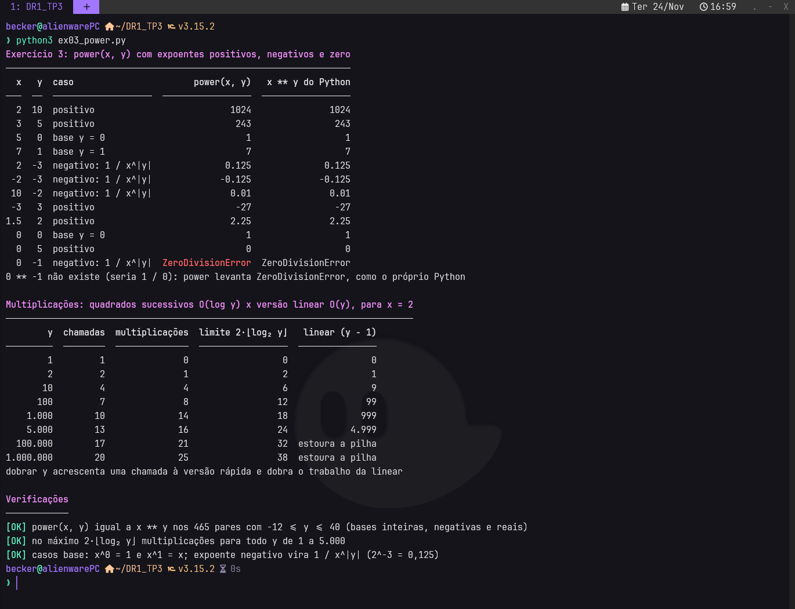

Casos base: x⁰ = 1 e x¹ = x. O expoente negativo vira positivo pela transformação x⁻ʸ = 1 / xʸ, e
0 com expoente negativo levanta `ZeroDivisionError`, como o `**`. O caso recursivo usa
xʸ = (x · x)^(y/2), vezes x quando y é ímpar: o expoente cai pela metade a cada chamada. Para
y = 1.000.000 foram **20 chamadas e 25 multiplicações**, contra 999.999 da versão linear, que nem roda
nesse tamanho por falta de pilha. Complexidade: **O(log y)**.

<!-- so-github -->
<p align="right"><a href="#sumario">⬆ voltar ao sumário</a></p>
<!-- /so-github -->

<a id="exercicio-4"></a>

## Exercício 4: Navegação recursiva em diretórios

<!-- so-github -->
 
<!-- /so-github -->

<!-- codigo: algoritmos/diretorios.py percorrer -->
```python
def percorrer(caminho, nivel=1, metricas=None):
    metricas = metricas or Metricas()
    metricas.entrar(nivel)
    try:
        with os.scandir(caminho) as leitura:
            entradas = sorted(leitura, key=_ordem)
    except PermissionError:
        return [Item(nivel, "[sem permissão de leitura]", False)]
    itens = []
    for entrada in entradas:
        if entrada.is_dir(follow_symlinks=False):
            itens.append(Item(nivel, entrada.name, True))
            itens += percorrer(entrada.path, nivel + 1, metricas)
        else:
            itens.append(Item(nivel, entrada.name, False))
    return itens
```
<!-- /codigo -->

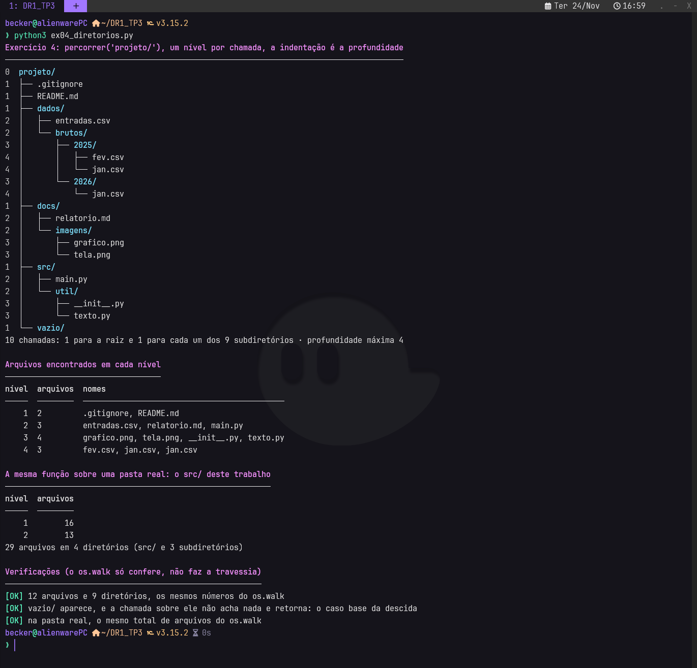

`os.scandir` lê só o nível atual; a descida é feita pela própria função, uma chamada por
subdiretório, com `nivel + 1`. O caso base é implícito: um diretório sem subdiretórios não chama
ninguém. A indentação vem do nível de cada item. Na árvore de exemplo foram **10 chamadas** (a raiz e
os 9 subdiretórios), profundidade 4, e os 12 arquivos e 9 diretórios conferem com o `os.walk`, usado
só na verificação. O custo é **O(D + A)**: cada diretório e cada arquivo são visitados uma vez.

<!-- so-github -->
<p align="right"><a href="#sumario">⬆ voltar ao sumário</a></p>
<!-- /so-github -->

<a id="exercicio-5"></a>

## Exercício 5: Geração recursiva de combinações (times)

<!-- so-github -->
 
<!-- /so-github -->

<!-- codigo: algoritmos/combinacoes.py teams -->
```python
def teams(candidates, k, metricas=None, nivel=1):
    if nivel == 1:
        if isinstance(k, bool) or not isinstance(k, int) or k < 0:
            raise ValueError("k deve ser um inteiro maior ou igual a zero")
        candidates = sem_repetidos(candidates)
    metricas = metricas or Metricas()
    metricas.entrar(nivel)
    if k == 0:
        return [""]
    if len(candidates) < k:
        return []
    primeiro, resto = candidates[0], candidates[1:]
    com_ele = [primeiro + time for time in teams(resto, k - 1, metricas, nivel + 1)]
    sem_ele = teams(resto, k, metricas, nivel + 1)
    return com_ele + sem_ele
```
<!-- /codigo -->

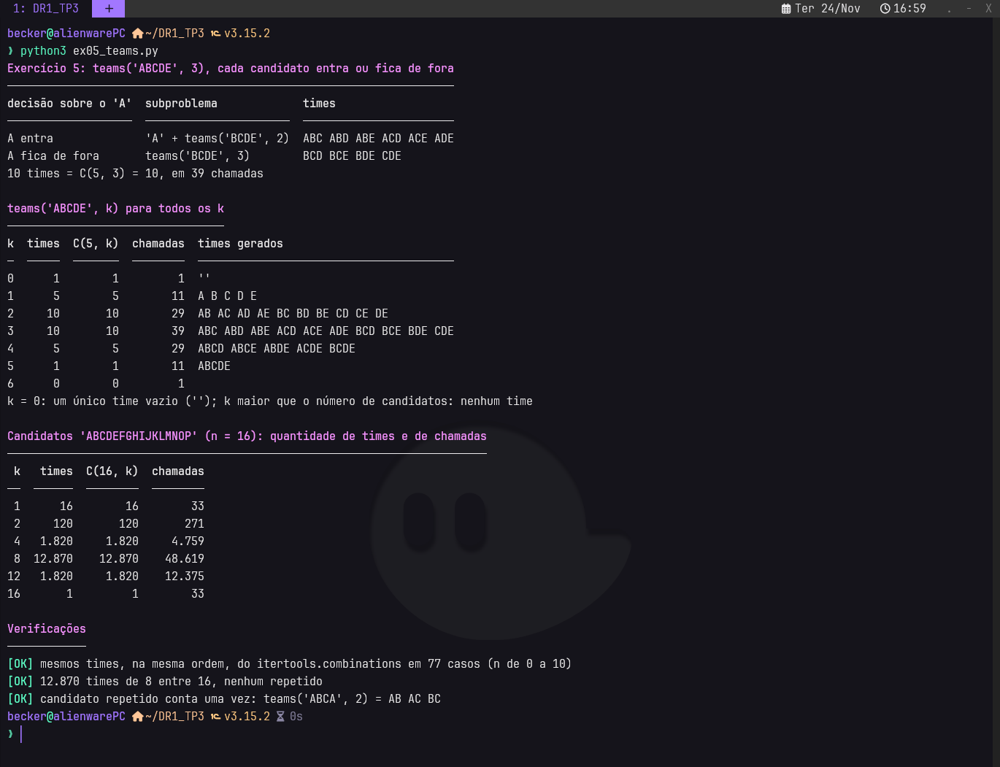

Para cada candidato há duas decisões: ele entra (e faltam k − 1 entre os demais) ou fica de fora (e
os k saem dos demais). Casos base: k = 0 é um time completo (`[""]`) e menos candidatos que k não
forma time. Como cada candidato é decidido uma vez por caminho, **nenhum time se repete**: as
quantidades são sempre C(n, k) e os 77 casos conferem com o `itertools.combinations`. Gerar os times
de todos os tamanhos é **O(2ⁿ)**, o tamanho da própria resposta.

<!-- so-github -->
<p align="right"><a href="#sumario">⬆ voltar ao sumário</a></p>
<!-- /so-github -->

<a id="exercicio-6"></a>

## Exercício 6: Problema da mochila (knapsack recursivo)

<!-- so-github -->
 
<!-- /so-github -->

<!-- codigo: algoritmos/mochila.py knapsack -->
```python
def knapsack(target, weights, index=0, metricas=None, ao_visitar=None, nivel=1):
    if nivel == 1:
        _exigir_pesos(target, weights)
    metricas = metricas or Metricas()
    metricas.entrar(nivel)
    if ao_visitar:
        ao_visitar(target, index, nivel)
    if target == 0:
        return [[]]
    if target < 0 or index == len(weights):
        return []
    peso = weights[index]
    com_ele = [[peso] + resto for resto in knapsack(target - peso, weights, index + 1, metricas, ao_visitar, nivel + 1)]
    sem_ele = knapsack(target, weights, index + 1, metricas, ao_visitar, nivel + 1)
    return com_ele + sem_ele
```
<!-- /codigo -->

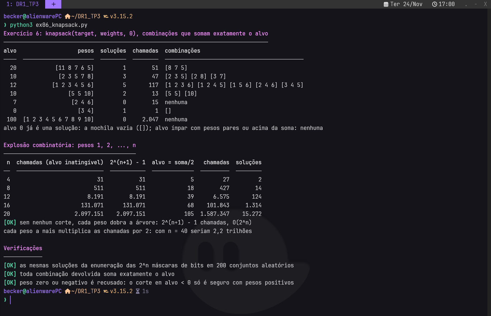

Casos base: alvo 0 é uma solução (`[[]]`); alvo negativo ou pesos esgotados, nenhuma (`[]`). As
combinações válidas ficam em listas. O exemplo clássico, alvo 20 com `[11 8 7 6 5]`, dá `[8 7 5]`.
Sem solução possível nenhum ramo é cortado e as chamadas são exatamente **2ⁿ⁺¹ − 1**: 2.097.151 com
20 pesos. Cada peso a mais dobra o trabalho: é a explosão combinatória, **O(2ⁿ)**.

<!-- so-github -->
<p align="right"><a href="#sumario">⬆ voltar ao sumário</a></p>
<!-- /so-github -->

<a id="exercicio-7"></a>

## Exercício 7: Análise de complexidade em algoritmos recursivos

<!-- so-github -->
 
<!-- /so-github -->

<!-- codigo: ex07_complexidade.py visitas -->
```python
def visitas(alvo, pesos):
    contagem = Counter()

    def registrar(alvo_restante, indice, _nivel):
        contagem[(alvo_restante, indice)] += 1

    knapsack(alvo, pesos, ao_visitar=registrar)
    return contagem
```
<!-- /codigo -->

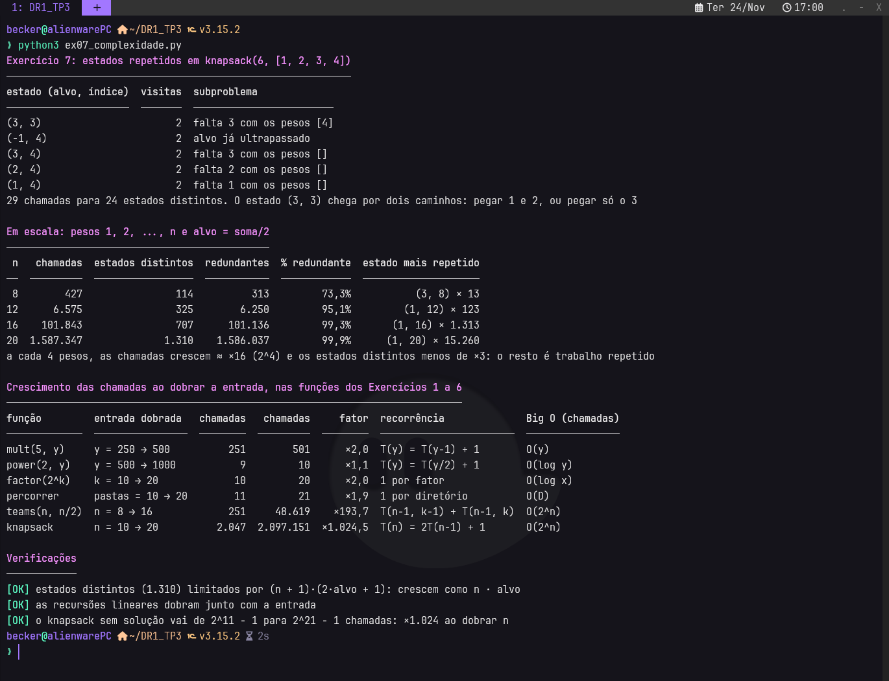

Escolhi o `knapsack` do Exercício 6. O resultado de uma chamada depende só do **alvo que falta** e do
**índice** do próximo peso, o estado do subproblema. Caminhos diferentes chegam ao mesmo estado (pegar
1 e 2, ou só o 3, deixa "falta 3 a partir do índice 3"), e a recursão pura refaz a subárvore em cada
visita. Com 20 pesos, **1.587.347 chamadas passaram por só 1.310 estados distintos**: 99,9% de
chamadas redundantes. A recorrência T(n) = 2T(n − 1) + 1 dá 2ⁿ⁺¹ − 1 chamadas, **O(2ⁿ)**.

| Função | Estrutura | Ao dobrar a entrada | Big O |
|---|---|---|---|
| mult | 1 chamada, reduz 1 | ×2,0 | O(y) |
| power | 1 chamada, divide por 2 | +1 chamada | O(log y) |
| factor | 1 chamada por fator | ×2,0 | O(log x) chamadas, O(√x) tentativas |
| percorrer | 1 chamada por diretório | ×1,9 | O(D + A) |
| teams | 2 chamadas, reduz 1 | ×193,7 | O(2ⁿ) |
| knapsack | 2 chamadas, reduz 1 | ×1.024,5 | O(2ⁿ) |

Uma chamada que reduz em 1 é linear, uma que divide por 2 é logarítmica, duas que reduzem em 1 são
exponenciais.

<!-- so-github -->
<p align="right"><a href="#sumario">⬆ voltar ao sumário</a></p>
<!-- /so-github -->

<a id="exercicio-8"></a>

## Exercício 8: Otimização com programação dinâmica

<!-- so-github -->
 
<!-- /so-github -->

<!-- codigo: algoritmos/mochila.py knapsack_memo,contar_combinacoes -->
```python
def knapsack_memo(target, weights, index=0, memo=None, metricas=None, nivel=1):
    if nivel == 1:
        _exigir_pesos(target, weights)
    memo = {} if memo is None else memo
    metricas = metricas or Metricas()
    metricas.entrar(nivel)
    if target == 0:
        return [[]]
    if target < 0 or index == len(weights):
        return []
    estado = (target, index)
    if estado in memo:
        return memo[estado]
    peso = weights[index]
    com_ele = [[peso] + resto for resto in knapsack_memo(target - peso, weights, index + 1, memo, metricas, nivel + 1)]
    sem_ele = knapsack_memo(target, weights, index + 1, memo, metricas, nivel + 1)
    memo[estado] = com_ele + sem_ele
    return memo[estado]

def contar_combinacoes(target, weights, index=0, memo=None, metricas=None, nivel=1):
    if nivel == 1:
        _exigir_pesos(target, weights)
    memo = {} if memo is None else memo
    metricas = metricas or Metricas()
    metricas.entrar(nivel)
    if target == 0:
        return 1
    if target < 0 or index == len(weights):
        return 0
    estado = (target, index)
    if estado not in memo:
        memo[estado] = (contar_combinacoes(target - weights[index], weights, index + 1, memo, metricas, nivel + 1)
                        + contar_combinacoes(target, weights, index + 1, memo, metricas, nivel + 1))
    return memo[estado]
```
<!-- /codigo -->

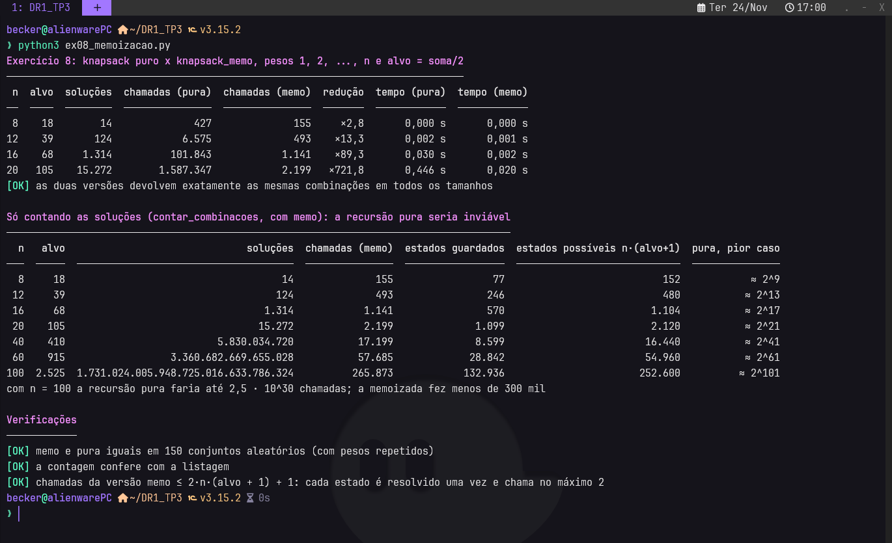

A versão memoizada guarda num dicionário a resposta de cada estado (alvo, índice); quem chega ao
mesmo estado por outro caminho recebe a resposta pronta. Com 20 pesos, as chamadas caíram de
**1.587.347 para 2.199** (722 vezes menos), com exatamente as mesmas combinações. Só contando as
soluções, 100 pesos foram resolvidos em 265.873 chamadas, onde a recursão pura precisaria de até
2¹⁰¹ ≈ 2,5 · 10³⁰. A complexidade cai de **O(2ⁿ)** para **O(n · alvo)**, ao custo da memória do
dicionário.

<!-- so-github -->
<p align="right"><a href="#sumario">⬆ voltar ao sumário</a></p>
<!-- /so-github -->

<a id="exercicio-9"></a>

## Exercício 9: QuickSort com o último elemento como pivô

<!-- so-github -->
 
<!-- /so-github -->

<!-- codigo: algoritmos/ordenacao.py particionar,_quicksort -->
```python
def particionar(lista, inicio, fim, metricas):
    pivo = lista[fim]
    esquerda, direita = inicio, fim - 1
    while True:
        while esquerda < fim:
            metricas.comparacoes += 1
            if lista[esquerda] >= pivo:
                break
            esquerda += 1
        while direita > inicio:
            metricas.comparacoes += 1
            if lista[direita] <= pivo:
                break
            direita -= 1
        if esquerda >= direita:
            break
        trocar(lista, esquerda, direita, metricas)
        esquerda += 1
        direita -= 1
    trocar(lista, esquerda, fim, metricas)
    return esquerda

def _quicksort(lista, inicio, fim, metricas, ao_particionar, nivel):
    metricas.entrar(nivel)
    if fim - inicio < 1:                    # caso base: 0 ou 1 elemento já está ordenado
        return
    pivo = particionar(lista, inicio, fim, metricas)
    if ao_particionar:
        ao_particionar(lista, inicio, fim, pivo, nivel)
    _quicksort(lista, inicio, pivo - 1, metricas, ao_particionar, nivel + 1)
    _quicksort(lista, pivo + 1, fim, metricas, ao_particionar, nivel + 1)
```
<!-- /codigo -->

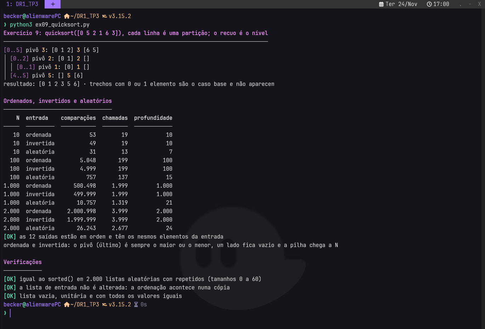

O pivô é o último elemento. O ponteiro da esquerda avança sobre os menores, o da direita recua sobre
os maiores, os dois trocam quando param e, quando se cruzam, o pivô vai para a posição final. A
recursão ordena os dois lados; o caso base é um trecho com 0 ou 1 elemento. Nas listas aleatórias a
profundidade ficou em 24 para N = 2.000 (**O(N log N)**). Nas ordenadas e invertidas o pivô é sempre
o maior ou o menor, um lado fica vazio, a pilha chega a N e as comparações a ≈ N²/2 (**O(N²)**).

<!-- so-github -->
<p align="right"><a href="#sumario">⬆ voltar ao sumário</a></p>
<!-- /so-github -->

<a id="exercicio-10"></a>

## Exercício 10: Instrumentação do QuickSort

<!-- so-github -->
 
<!-- /so-github -->

<!-- codigo: algoritmos/ordenacao.py trocar -->
```python
def trocar(lista, i, j, metricas):
    if i == j:
        return
    temp = lista[i]
    lista[i] = lista[j]
    lista[j] = temp
    metricas.copias += 3
```
<!-- /codigo -->

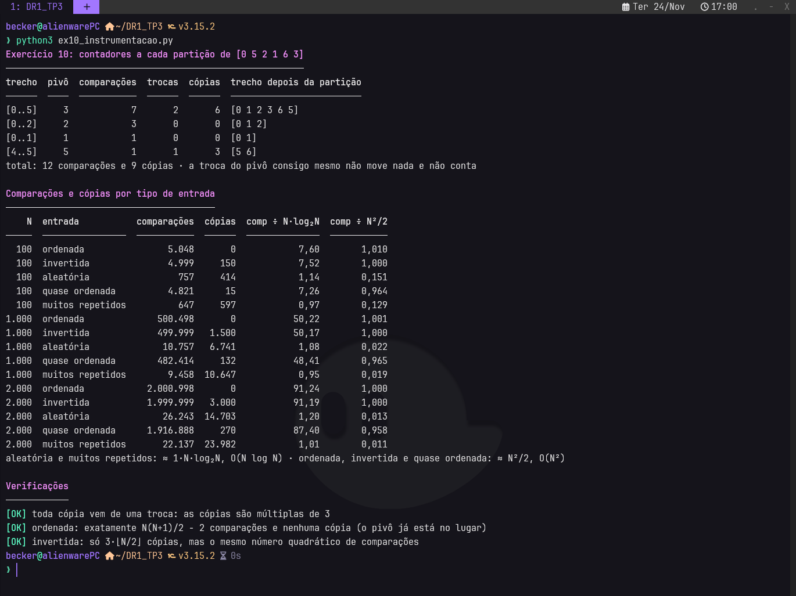

Cada comparação com o pivô soma 1 e cada troca soma 3 cópias (temp = a; a = b; b = temp); trocar uma
posição com ela mesma não move nada e não conta.

| Entrada (N = 2.000) | Comparações | Cópias |
|---|---|---|
| ordenada | 2.000.998 | 0 |
| invertida | 1.999.999 | 3.000 |
| quase ordenada | 1.916.888 | 270 |
| aleatória | 26.243 | 14.703 |
| muitos repetidos | 22.137 | 23.982 |

As comparações dependem da posição do pivô: entradas ordenadas, mesmo que só em parte, levam ao
O(N²). As cópias dependem de quanto há para mover: a ordenada não troca nada. A lista quase ordenada
fica a 96% do pior caso, porque os maiores continuam no fim; um pivô aleatório evitaria isso.

<!-- so-github -->
<p align="right"><a href="#sumario">⬆ voltar ao sumário</a></p>
<!-- /so-github -->

<a id="exercicio-11"></a>

## Exercício 11: QuickSelect

<!-- so-github -->
 
<!-- /so-github -->

<!-- codigo: algoritmos/ordenacao.py _quickselect,quickselect -->
```python
def _quickselect(lista, inicio, fim, k, metricas, ao_particionar, nivel):
    metricas.entrar(nivel)
    if inicio == fim:                       # caso base: sobrou um elemento, e ele é o procurado
        return lista[inicio]
    pivo = particionar(lista, inicio, fim, metricas)
    if ao_particionar:
        ao_particionar(lista, inicio, fim, pivo, nivel)
    if pivo == k:                           # o pivô caiu na posição procurada: para aqui
        return lista[pivo]
    if k < pivo:
        return _quickselect(lista, inicio, pivo - 1, k, metricas, ao_particionar, nivel + 1)
    return _quickselect(lista, pivo + 1, fim, k, metricas, ao_particionar, nivel + 1)

def quickselect(seq, k, metricas=None, ao_particionar=None):
    if isinstance(k, bool) or not isinstance(k, int) or not 0 <= k < len(seq):
        raise IndexError(f"k deve estar entre 0 e {len(seq) - 1}")
    metricas = metricas or Metricas()
    lista = list(seq)
    return _quickselect(lista, 0, len(lista) - 1, k, metricas, ao_particionar, 1)
```
<!-- /codigo -->

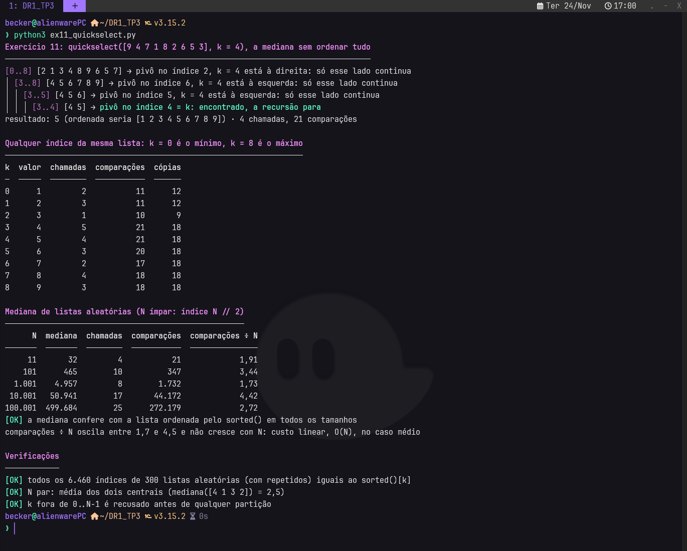

Usa a mesma partição do QuickSort. Depois dela o pivô está na posição definitiva: se a posição é k,
a recursão **para**; senão, segue só pelo lado que contém k. Qualquer índice de 0 a N − 1 pode ser
pedido, e os 6.460 índices testados conferem com `sorted()[k]`. Para a mediana de 100.001 elementos
foram 272.179 comparações, 2,7 por elemento, e essa razão não cresce com N: **O(N)** no caso médio.

<!-- so-github -->
<p align="right"><a href="#sumario">⬆ voltar ao sumário</a></p>
<!-- /so-github -->

<a id="exercicio-12"></a>

## Exercício 12: Comparação entre QuickSort e QuickSelect

<!-- so-github -->
 
<!-- /so-github -->

<!-- codigo: ex12_quicksort_x_quickselect.py comparar -->
```python
def comparar(dados):
    k = len(dados) // 2
    ordenada, m_ordenacao = medir(quicksort, dados)
    selecionado, m_selecao = medir(quickselect, dados, k)
    return ordenada[k] == selecionado, m_ordenacao, m_selecao
```
<!-- /codigo -->

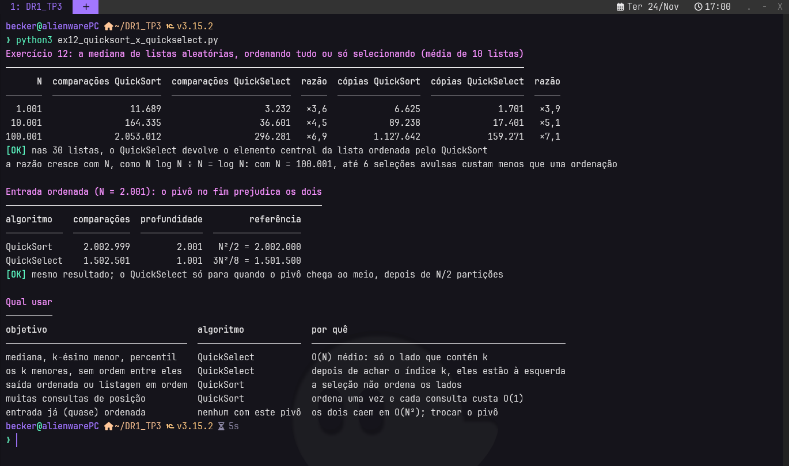

Nas mesmas listas (média de 10 por tamanho), o QuickSelect fez de **3,6 a 6,9 vezes menos
comparações** e de 3,9 a 7,1 vezes menos cópias que o QuickSort, e a vantagem cresce com N, como
N log N ÷ N = log N. Na lista ordenada os dois degradam: ≈ N²/2 e ≈ 3N²/8 comparações.

| Objetivo | Algoritmo |
|---|---|
| mediana, k-ésimo menor, percentil, os k menores | QuickSelect, O(N) médio |
| saída ordenada ou muitas consultas de posição | QuickSort, O(N log N), e cada consulta em O(1) |
| entrada já (quase) ordenada | trocar o pivô: com o último elemento, os dois caem em O(N²) |

Conclusão: quando a pergunta é sobre uma posição, ordenar tudo paga log N a mais por uma informação
que não será usada.

<!-- so-github -->
<p align="right"><a href="#sumario">⬆ voltar ao sumário</a></p>
<!-- /so-github -->

<a id="testes"></a>

## Testes automatizados

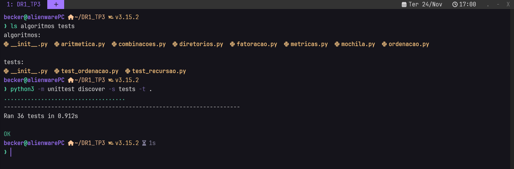

<!-- so-github -->
<p align="right"><a href="#sumario">⬆ voltar ao sumário</a></p>
<!-- /so-github -->

<a id="referencias"></a>

## Referências

- BELLMAN, R. *Dynamic programming*. Princeton: Princeton University Press, 1957.
- CANNING, J.; BRODER, A.; LAFORE, R. *Data structures & algorithms in Python*. Boston: Addison-Wesley, 2022.
- CORMEN, T. H. et al. *Algoritmos: teoria e prática*. 3. ed. Rio de Janeiro: Elsevier, 2012.
- HOARE, C. A. R. Algorithm 65: Find. *Communications of the ACM*, v. 4, n. 7, p. 321-322, 1961.
- HOARE, C. A. R. Quicksort. *The Computer Journal*, v. 5, n. 1, p. 10-16, 1962.
- WENGROW, J. *A common-sense guide to data structures and algorithms in Python*: volume 1. Raleigh: The Pragmatic Bookshelf, 2023.

<!-- so-github -->
<p align="right"><a href="#sumario">⬆ voltar ao sumário</a></p>
<!-- /so-github -->

<a id="video"></a>

## Vídeo de defesa

Vídeo de 4 a 6 minutos com a explicação de quatro exercícios e a execução no terminal, no Google
Drive institucional, com permissão de visualização para qualquer pessoa com o link.

<!-- video: https://drive.google.com/file/d/1VNHyDmpfNLSiB2b_dhdRqPqfP660OhE2/view?usp=sharing -->
**Link do vídeo:** [assistir no Google Drive](https://drive.google.com/file/d/1VNHyDmpfNLSiB2b_dhdRqPqfP660OhE2/view?usp=sharing)
<!-- /video -->
